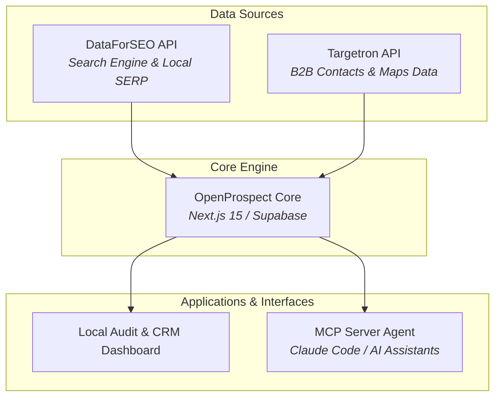

<div align="center">

# 🎯 OpenProspect

### The Open-Source Local SEO Audit & B2B Lead Enrichment Engine

*Turn local search visibility gaps into actionable, enriched B2B outreach pipelines.*

[](LICENSE)
[](https://nextjs.org/)
[](https://dataforseo.com/)
[](https://targetron.com/)
[](https://modelcontextprotocol.io/)

[Features](#-key-features) • [Architecture](#-architecture--data-pipeline) • [Environment Setup](#-environment-variables) • [Self-Hosting](#-self-hosting) • [Local Development](#-local-development) • [Acknowledgements](#-acknowledgements)

---

</div>

## 📌 Overview

**OpenProspect** is a self-hosted, open-source platform that bridges the gap between **Search Engine Visibility** and **B2B Decision-Maker Intelligence**. 

Forked and expanded from [OpenSEO](https://github.com/every-app/open-seo), OpenProspect combines local rank tracking, SERP gap analysis, and keyword data from **DataForSEO** with real-world Google Maps metadata, verified decision-maker contacts, and company profiles powered by **Targetron**.

Say goodbye to per-location SaaS taxes and rigid prospecting subscriptions. OpenProspect runs entirely on transparent, usage-based pay-as-you-go APIs.

---

## 🔥 Key Features

* 📍 **Hyper-Local SERP & Competitor Audits:** Identify local businesses ranking on page 2 or 3 for high-value commercial intent keywords using DataForSEO's city-level search engine data.
* 🎛️ **Targetron B2B Enrichment:** Instantly pull decision-maker names, verified direct emails, phone numbers, Google Place IDs, and Google Maps review metrics for any audited domain.
* 🚀 **Local Programmatic SEO (pSEO) Ready:** Generate structured datasets pairing physical location metadata (lat/long, business hours, GBP attributes) with search volume metrics for programmatic landing pages.
* 🤖 **AI-Native MCP Integration:** Native Model Context Protocol (MCP) server support allows AI agents (like Claude Code or OpenClaw) to run local competitor audits, score leads, and write personalized outreach copy directly from your terminal.
* 💰 **Zero Monthly Platform Fees:** Fully open-source under the MIT license. Pay only for the raw API credits you consume through DataForSEO and Targetron.

---

## 🏗️ Architecture & Data Pipeline


## 🤖 OpenProspect MCP & Agent Skills

OpenProspect exposes an extended MCP server so AI agents can query search performance alongside lead enrichment metrics directly from your CLI or agent environment:

* **`prospector.search_local_leads`**: Scans DataForSEO for targeted local keywords and flags low-ranking domains.
* **`prospector.enrich_domain`**: Queries Targetron to retrieve business profiles, Google Place IDs, and decision-maker contact details.

---

## 🚀 Self-Hosting

OpenProspect supports two self-hosting paths:

* **Simple: Docker (Best for local testing)**  
  See [`docs/SELF_HOSTING_DOCKER.md`](./docs/SELF_HOSTING_DOCKER.md).
* **Recommended: Cloudflare Pages / Workers**  
  For internet-facing self-hosting across multiple devices or team workflows (works on Cloudflare's free plan). See [`docs/SELF_HOSTING_CLOUDFLARE.md`](./docs/SELF_HOSTING_CLOUDFLARE.md).

---

## 💻 Local Development

See [`docs/LOCAL_DEVELOPMENT.md`](./docs/LOCAL_DEVELOPMENT.md).

```sh
git clone [https://github.com/edumbao/openseo-b2b-prospector.git](https://github.com/edumbao/openseo-b2b-prospector.git)
cd openseo-b2b-prospector
pnpm install
pnpm dev

---

## 🙏 Acknowledgements

OpenProspect is built as an extended fork of OpenSEO created by Ben Senescu and contributors.

```sh
# Upstream repository
[https://github.com/every-app/open-seo](https://github.com/every-app/open-seo)
